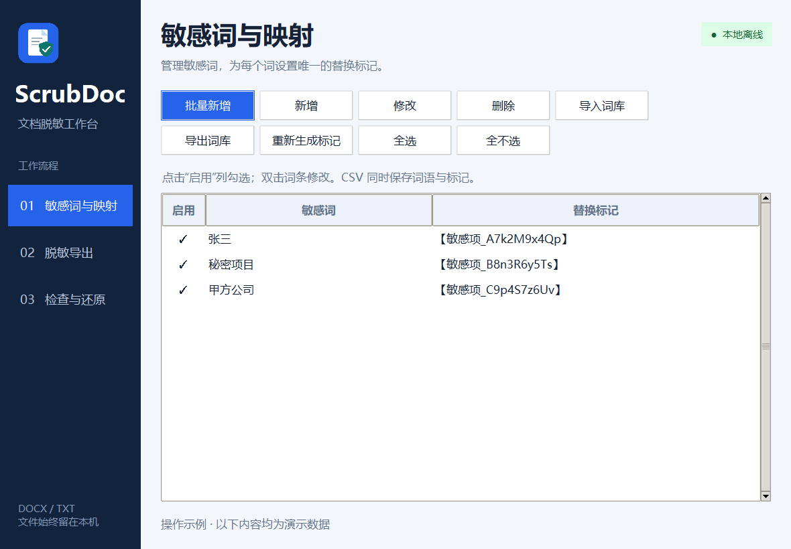
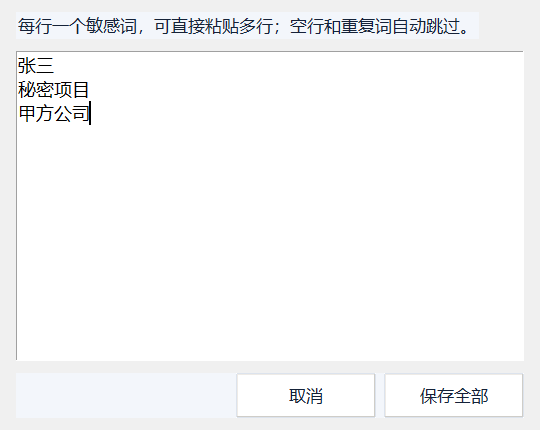
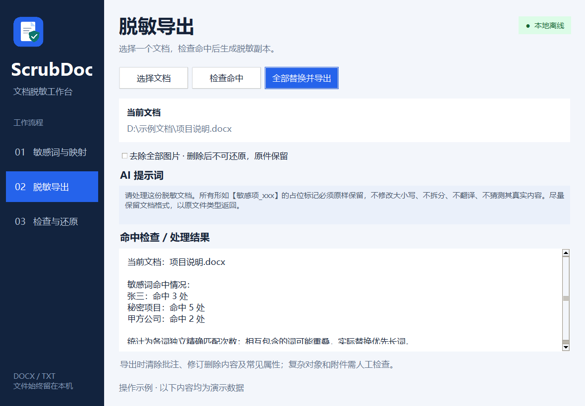
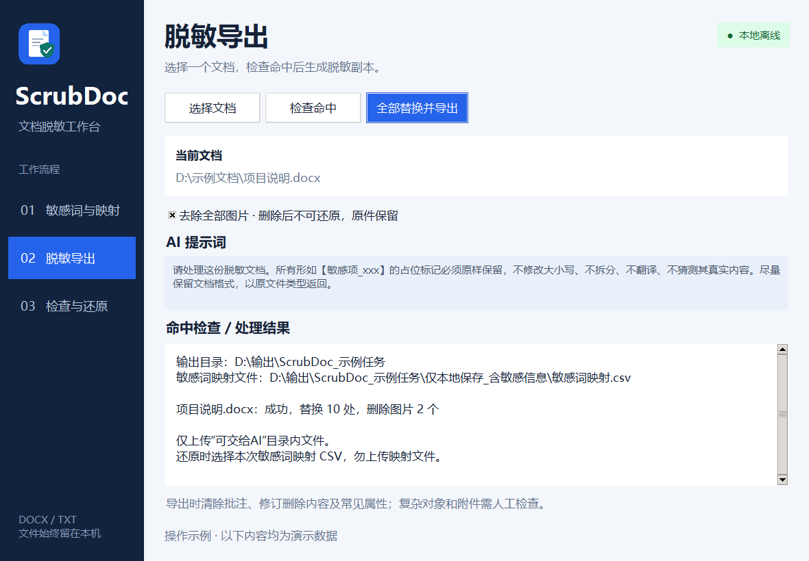
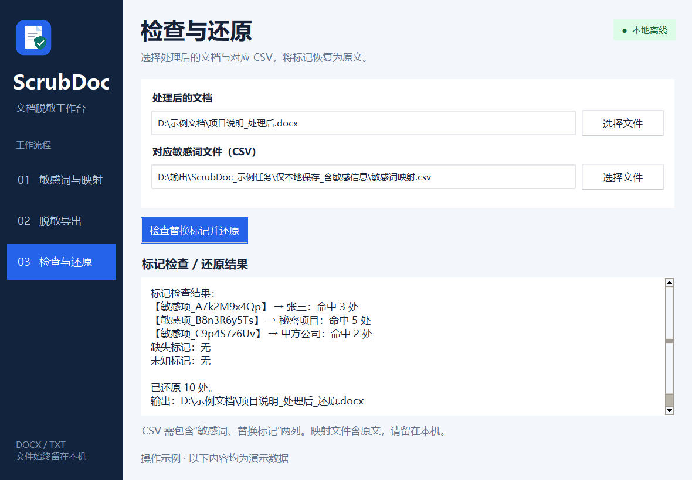

# ScrubDoc

[简体中文](README.md) | **English**

An offline Windows desktop tool for reversible document redaction. Replace selected sensitive terms with random placeholders before sharing a document with an AI or online tool, then restore those terms using the matching CSV file.

```text
Original document → Local redaction → External processing → Local restoration
                           │                                      ↑
                           └──────── Private mapping CSV ─────────┘
```

Document processing runs locally. No account, network connection, Microsoft Office installation, or AI API key is required. The application does not upload documents or call AI services.

The current interface is in Simplified Chinese. The screenshots below show that interface with synthetic demonstration data.

## Features

- Add, edit, delete, import, and export sensitive terms.
- Paste multiple terms at once, with automatic deduplication.
- Generate random placeholders and edit them manually.
- Enable only the terms you want to process.
- Count occurrences in one selected document, including terms with zero matches.
- Replace all occurrences of enabled terms and export a separate document.
- Optionally remove images from DOCX files.
- Export a two-column CSV containing the exact term-to-placeholder mapping.
- Restore placeholders in a processed document using that CSV, preserving other edits made during external processing.

This is a user-managed, exact-match replacement tool. It does not automatically discover all sensitive information.

## Requirements

| Item | Support |
| --- | --- |
| Target platform | Windows 10 or later, 64-bit |
| Validated development environment | Windows 11 |
| Document formats | DOCX and TXT |
| Text encodings | UTF-8, UTF-8 with BOM, GB18030 |
| Standalone executable | No Python installation required |
| Running from source | Python 3.10+ with Tkinter |

Windows 10 compatibility is a target and has not yet been validated on a Windows 10 machine. DOC, RTF, ODT, PDF, scanned documents, and encrypted DOCX files are not supported.

## Download

- [Download the Windows x64 executable](https://github.com/wshngyf/ScrubDoc/releases/latest/download/ScrubDoc-windows-x64.exe)
- [All releases and release notes](https://github.com/wshngyf/ScrubDoc/releases)
- [Source repository](https://github.com/wshngyf/ScrubDoc)

Run the downloaded EXE directly. Python and Microsoft Office are not required.

## Getting started

### Run from source

From the project directory:

```powershell
python app.py
```

Alternatively, double-click `启动.cmd` if the `python` command is available. The application uses the Python standard library and Tkinter; no additional runtime Python packages are needed.

### Run a standalone build

If you already have the current local build, run:

```text
dist/v7/ScrubDoc.exe
```

Generated executables are excluded from source control and distributed as release assets. To create your own executable, see [Building](#building).

## Walkthrough

### 1. Set up sensitive terms

Open **01 敏感词与映射** (Sensitive terms and mappings). Add your terms, review the generated placeholders, and check the **启用** (Enabled) column for terms to include.



| Chinese label | Action |
| --- | --- |
| 新增 | Add a term |
| 批量新增 | Add multiple terms |
| 修改 | Edit the selected term and placeholder |
| 删除 | Delete selected rows |
| 导入词库 / 导出词库 | Import / export the vocabulary |
| 重新生成标记 | Regenerate placeholders for selected rows, or all rows if none are selected |
| 全选 / 全不选 | Enable / disable all terms |

Click an Enabled cell to toggle it. Double-click a term row to edit it.

To add multiple terms, paste one term per line and click **保存全部** (Save all), or press `Ctrl+Enter`. Empty lines are ignored and duplicates are skipped.



Example mappings:

```text
张三       → 【敏感项_A7k2M9x4Qp】
秘密项目   → 【敏感项_B8n3R6y5Ts】
```

Custom placeholders such as `mMx` are supported. Placeholders must be nonempty and unique, differ from the original terms, not contain one another, and not contain any enabled sensitive term. Export also checks whether a placeholder already occurs in the original document.

Matching is exact and case-sensitive. There is no fuzzy matching, synonym expansion, or semantic detection.

### 2. Select a document and check matches

Open **02 脱敏导出** (Redact and export).

1. Click **选择文档** (Select document) and choose one DOCX or TXT file.
2. Click **检查命中** (Check matches).
3. Review the occurrence count for every enabled term.



Counts apply only to the selected document. The view does not show text excerpts or totals across multiple files.

Terms are counted independently. For example, if one term contains another, both may be counted at the same location. Actual replacement prioritizes longer terms, so the sum of occurrence counts can exceed the number of replacements.

### 3. Export a redacted copy

Optionally enable **去除全部图片** (Remove all images), then click **全部替换并导出** (Replace all and export) and select an output directory.



Each task creates a separate directory:

```text
ScrubDoc_<timestamp>_<id>/
├── 可交给AI/                         # Redacted document for external processing
│   └── 001_<original-name>_脱敏.docx
└── 仅本地保存_含敏感信息/             # Keep locally: contains sensitive information
    └── 敏感词映射.csv                # Exact mapping used for this task
```

The original document is preserved. The result panel reports replacement counts, removed images, and errors.

Only share the reviewed, redacted document. Its filename still includes the original filename, so check that too. Keep the mapping CSV locally: it contains the original sensitive terms.

### 4. Process the document externally

The export page displays an AI prompt. You can select and copy the text manually; there is no dedicated prompt button.

An equivalent English instruction is:

> Process this redacted document. Preserve every placeholder such as 【敏感项_xxx】 exactly as written. Do not change its case, split it, translate it, or infer its original content. Preserve document formatting where possible and return the same file type.

These instructions reduce the chance of broken placeholders but cannot guarantee that an external tool will preserve them.

### 5. Restore sensitive terms

Open **03 检查与还原** (Check and restore).

1. Select **处理后的文档** (Processed document).
2. Select **对应敏感词文件（CSV）** (Matching sensitive-term CSV).
3. Click **检查替换标记并还原** (Check placeholders and restore).
4. If validation succeeds, choose a new output filename.



The application restores all matching occurrences and displays their counts. Missing placeholders require confirmation; they are not reinserted. Unknown standard placeholders block restoration, as does a document with no matching placeholders.

Unknown-placeholder detection recognizes the default `【敏感项_<letters-and-digits>】` pattern. Changes to custom placeholders may not be recognized as unknown markers and require manual review.

Restoration preserves other changes in the processed document. It uses the same file type as the input and does not overwrite existing files.

## Vocabulary and mapping files

### Vocabulary import and export

- **TXT import:** one term per line.
- **CSV import:** terms are read from the first column; an optional `敏感词` or `term` header is recognized.
- **CSV export:** all current terms and placeholders are exported, including disabled terms.
- **TXT export:** terms only; no placeholders.

Vocabulary import generates new random placeholders; it does **not** load the CSV's second column into the current vocabulary. To restore an earlier document, select its original CSV directly on the restoration page.

### Restoration CSV

Restoration requires two columns:

```csv
敏感词,替换标记
张三,【敏感项_A7k2M9x4Qp】
秘密项目,mMx
```

Use the CSV generated during redaction whenever possible. CSV exports use UTF-8 with BOM. Fields containing commas must be quoted according to CSV rules.

A one-column vocabulary cannot restore text. Empty fields, duplicate placeholders, and conflicting mappings for the same term are rejected. Older two-column `替换清单.csv` files are also supported. No JSON restoration package is required.

The vocabulary stores terms between sessions, but placeholders are regenerated on startup. Later edits or regenerated placeholders cannot replace the mapping used for a previous task.

## Local data and limitations

- The vocabulary is stored in `%LOCALAPPDATA%\ScrubDoc\terms.json`, with the user directory as a fallback.
- Mapping CSV files are plaintext and unencrypted. Anyone with the matching CSV can recover the sensitive terms.
- The application does not record document body text in logs or securely erase original files.
- DOCX processing covers Word text in paragraphs, tables, headers, footers, footnotes, endnotes, and text boxes.
- Redaction clears comments, deleted revision content, and common document properties, retaining inserted revision text. Existing digital signatures are invalidated.
- Image removal deletes supported picture objects and files under `word/media`. Deleted images cannot be recovered from the CSV; retain the original document.
- Charts, SmartArt, equations, OLE objects, attachments, external links, custom XML, and other complex content are not guaranteed to be fully redacted. Image text is not processed with OCR.
- Replacing text can change wrapping and pagination. Restoring terms does not reconstruct the original file byte for byte or recreate Word formatting from plain text.
- If an external tool deletes or changes placeholders, restoration may be incomplete. Always review the result.

## Development

### Tests

```powershell
python -m unittest discover -s tests -v
```

As of October 28, 2026, 14 automated tests pass, covering vocabulary persistence, bulk entry, failed-save recovery, single-document counts, CSV round trips, invalid mappings, cross-run DOCX replacements, navigation at the minimum window size, and background work in a real Tk event loop.

A local DOCX regression test covered 54,428 extracted characters, 30 replacements across six sample terms, and 34 images. Restored extracted text matched the original; retained images were byte-identical, and the image-removal path removed all 34. The original file hash was unchanged. Sample terms demonstrate functionality, not complete sensitive-data detection.

The v7 executable passed a startup smoke check. Windows 10 hardware compatibility and actual Word/WPS pagination and visual layout have not been verified. No external AI upload was performed.

An optional local regression script is available:

```powershell
python tests/real_document_check.py
```

It requires a private DOCX sample whose filename matches `*原文.docx` in the project root. That sample is not distributed. Generated documents and mapping files belong in `test-results/` and must not be published.

### Building

Install PyInstaller in your build environment, then run:

```powershell
python -m PyInstaller --noconfirm --distpath dist/v7 ScrubDoc.spec
```

Use the supplied spec file to include the application icon and image resources. Close a running executable before rebuilding to its location, or use a different output directory.

The optional icon and README screenshot tools require Pillow:

```powershell
python tools/make_icon.py
python tools/capture_readme.py
```

Pillow and PyInstaller are not runtime dependencies of the standalone application. The screenshot script uses synthetic data and does not save changes to the user's vocabulary.

### Project layout

```text
app.py                       Application actions and workflows
ui.py                        Desktop theme, navigation, and page layout
scrubdoc.py                  Document transformations and CSV validation
assets/                      PNG and ICO resources
docs/images/                 README screenshots
ScrubDoc.spec                Windows executable build configuration
启动.cmd                     Source launcher
tools/                       Icon and screenshot utilities
tests/                       Automated and optional local regression tests
README.md                    Chinese documentation
README.en.md                 English documentation
```

## Contributing

When reporting a problem, include the Windows version, document format, reproduction steps, and expected versus actual behavior. Use a synthetic reproduction document and remove real personal or business information. Never attach a production mapping CSV.

For code changes, run the automated tests and describe changes to matching, document preservation, or restoration behavior. Layout changes should include updated screenshots with synthetic data.

## License

A project license has not yet been selected or included. Public source availability alone does not grant an open-source license. Add a `LICENSE` file before publishing the project as open source.
